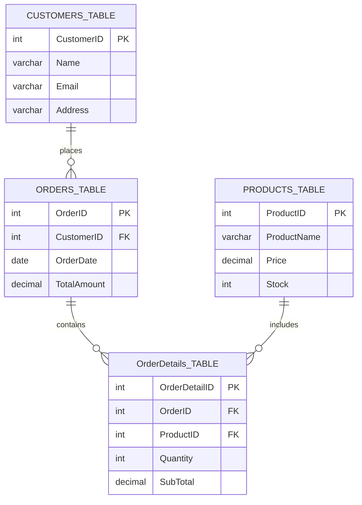

<!--
  DATA DIGGER SQL | GitHub README
  Replace YOUR_GOOGLE_DRIVE_FILE_ID with your actual Google Drive video file ID.
-->

<div align="center">


<br/>

<p>
  
  
  
  
</p>

### ⚡ Explore Data. Discover Insights. Master SQL.

*A hands-on MySQL project that models an e-commerce database and transforms relational data into meaningful business insights.*

<br/>

<a href="https://github.com/PalAnghan/Data_Digger_SQL">
  
</a>
<a href="https://drive.google.com/file/d/YOUR_GOOGLE_DRIVE_FILE_ID/view">
  
</a>

</div>

---

## ◈ About the Project

**Data Digger SQL** is a relational database project built with MySQL to simulate the data management needs of an e-commerce business.

The project organizes customer information, orders, products, and order details into four related tables. It demonstrates how SQL can create structured databases, maintain relationships, perform CRUD operations, and answer practical business questions.

The goal is not just to store data — it is to learn how to query, organize, and analyze it.

## ✦ Project Highlights

<table>
<tr>
<td width="50%" valign="top">

### 🗄️ Relational Database
Four interconnected tables with primary and foreign keys.

</td>
<td width="50%" valign="top">

### ⚡ CRUD Operations
Create, read, update, and delete database records.

</td>
</tr>
<tr>
<td width="50%" valign="top">

### 📊 Business Analytics
Calculate revenue, minimum and maximum values, and averages.

</td>
<td width="50%" valign="top">

### 🔍 Smart Queries
Filter records, sort products, group quantities, and rank results.

</td>
</tr>
</table>

## 🧩 Database Architecture

The database contains four tables, each with a specific responsibility.



<details>
<summary><b>01 — Customers Table</b></summary>

Stores customer names, email addresses, and addresses.

**Key concept:** Primary keys and unique record identification.

</details>

<details>
<summary><b>02 — Orders Table</b></summary>

Stores customer orders, order dates, and order amounts.

**Key concept:** Foreign keys and customer-to-order relationships.

</details>

<details>
<summary><b>03 — Products Table</b></summary>

Stores product names, prices, and stock quantities.

**Key concept:** Sorting, filtering, and price analysis.

</details>

<details>
<summary><b>04 — OrderDetails Table</b></summary>

Connects orders with products and records quantities and subtotals.

**Key concept:** Relational joins, aggregation, and sales analysis.

</details>

## 🚀 SQL Concepts Demonstrated

| SQL concept | Application |
|---|---|
| `CREATE TABLE` | Create database tables |
| `INSERT INTO` | Add sample records |
| `SELECT` | Retrieve records |
| `UPDATE` | Modify customer, order, or product data |
| `DELETE` | Remove selected records |
| `WHERE` | Filter records using conditions |
| `ORDER BY` | Sort products by price |
| `BETWEEN` | Find products in a price range |
| `GROUP BY` | Group order details by product |
| `SUM()` and `COUNT()` | Analyze revenue and sales records |
| `MAX()`, `MIN()`, `AVG()` | Calculate summary statistics |
| `LIMIT` | Return the top three products |
| `CURDATE()` and `INTERVAL` | Filter orders by date |
| Primary and foreign keys | Maintain relational integrity |

## 📈 Example: Sales Analytics

### Find total revenue

```sql
SELECT SUM(SubTotal) AS Total_Revenue
FROM OrderDetails_TABLE;
```

Calculates the sum of all recorded order-detail subtotals.

### Identify the top three products by quantity

```sql
SELECT
    ProductID,
    SUM(Quantity) AS Total_Quantity
FROM OrderDetails_TABLE
GROUP BY ProductID
ORDER BY Total_Quantity DESC
LIMIT 3;
```

Groups records by product, calculates total quantities, and returns the three highest results.

### Find products in a price range

```sql
SELECT *
FROM PRODUCTS_TABLE
WHERE Price BETWEEN 500 AND 2000;
```

Returns products priced between ₹500 and ₹2,000, including both endpoints.

## 🎬 Project Demo Video

<div align="center">

### ▶️ See Data Digger SQL in Action

**Watch the project demonstration on Google Drive.**

<a href="https://drive.google.com/file/d/YOUR_GOOGLE_DRIVE_FILE_ID/view">
  
</a>

<br/><br/>

*The demonstration showcases SQL scripts, table creation, sample data, query execution, and result sets.*

</div>

> **Setup required:** Replace `YOUR_GOOGLE_DRIVE_FILE_ID` in both demo links with your actual Google Drive video file ID. Set the video's General access to **Anyone with the link** and Viewer permission so visitors can watch it.

## 🛠️ Technologies Used

<div align="center">


</div>

## 💻 Getting Started

### Prerequisites

- MySQL Server
- Visual Studio Code or another SQL editor
- A MySQL extension or client configured to connect to your database

### Installation and Setup

**1. Clone the repository**

```bash
git clone https://github.com/PalAnghan/Data_Digger_SQL.git
```

**2. Open the project**

```bash
cd Data_Digger_SQL
```

**3. Open the SQL scripts**

Open the repository in your SQL editor and connect to your local MySQL server.

**4. Select the database**

```sql
CREATE DATABASE IF NOT EXISTS DATA_DIGGER;
USE DATA_DIGGER;
```

**5. Execute the SQL scripts in dependency order**

Run the scripts in this sequence:

1. `Customer_table.sql`
2. `Orders_table.sql`
3. `Products_table.sql`
4. `OrderDetails_table.sql`

Make sure the parent tables exist before creating dependent foreign-key relationships. Check existing records before rerunning insert statements to avoid adding duplicate sample data.

## 🎯 Learning Outcomes

By completing this project, I practiced:

- Designing a relational database schema.
- Creating tables and defining relationships.
- Applying primary keys, foreign keys, and auto-increment columns.
- Executing CRUD operations.
- Writing filtering and sorting queries.
- Using aggregate functions for data analysis.
- Grouping and ranking products by sales quantity.
- Troubleshooting foreign-key constraint errors.
- Managing and documenting SQL projects with GitHub.

## 🔮 Future Improvements

- Add JOIN queries for complete customer-order-product reports.
- Add sales analysis by month and customer.
- Implement stock validation and inventory tracking.
- Add sample reports and query-result screenshots.
- Build a dashboard to visualize sales and product performance.

## 👨‍💻 About the Developer

<div align="center">


**Pal Anghan**

*Aspiring Data & AI Professional | SQL Learner | Developer*

I enjoy building practical projects, exploring data, and continuously improving my programming and analytical skills.

<br/>

<a href="https://github.com/PalAnghan">
  
</a>
<a href="https://www.linkedin.com/in/pal-anghan-7733402b4/">
  
</a>

</div>

---

<div align="center">

### ✨ Thanks for visiting Data Digger SQL!

*Keep learning. Keep building. Keep exploring data.*


</div>
